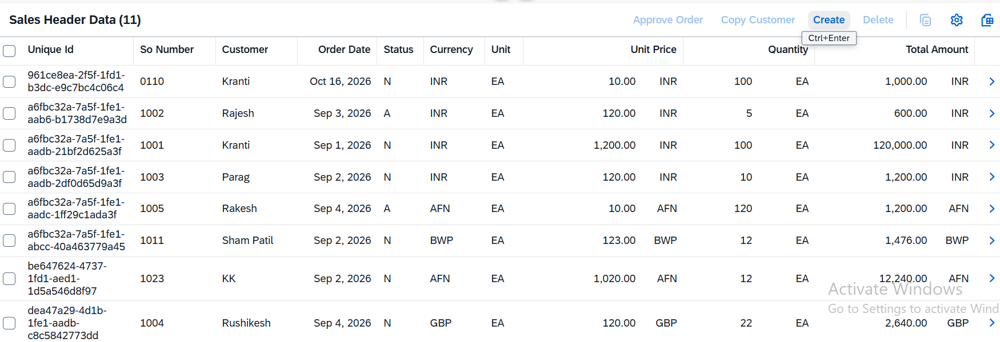
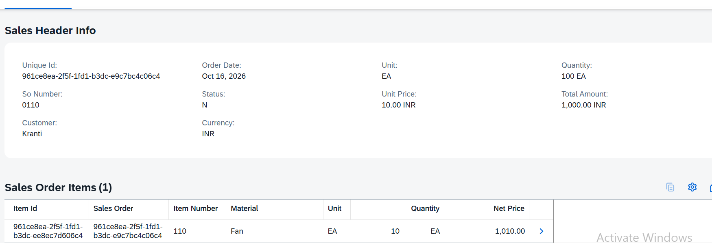
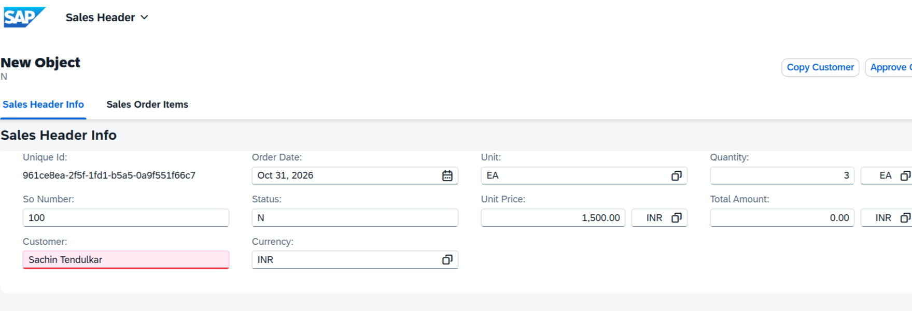
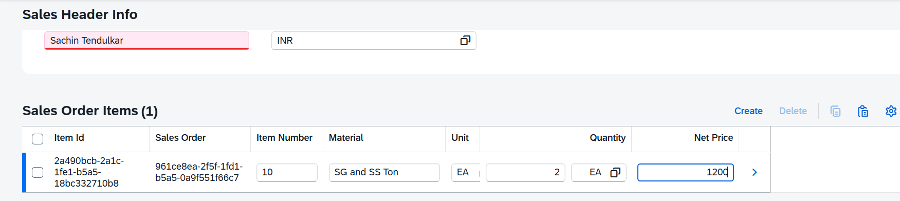
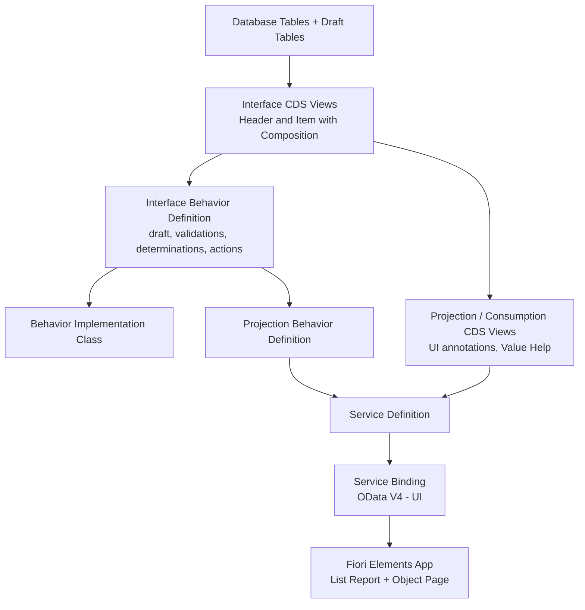

# 🧾 SAP RAP Sales Order App

> An end-to-end **ABAP RESTful Application Programming Model (RAP)** project: a Sales Order application with Header and Items, built on **SAP BTP ABAP Environment**, exposed as **OData V4**, and consumed through a **Fiori Elements** UI.


---

## 📌 Table of Contents

1. [Overview](#-overview)
2. [Features](#-features)
3. [Tech Stack](#-tech-stack)
4. [Screenshots](#-screenshots)
5. [Architecture](#-architecture)
6. [Data Model](#-data-model)
7. [Development Objects](#-development-objects)
8. [Business Logic](#-business-logic)
9. [UI and Annotations](#-ui-and-annotations)
10. [Repository Structure](#-repository-structure)
11. [Getting Started](#-getting-started)
12. [How to Use the App](#-how-to-use-the-app)
13. [Key Learnings](#-key-learnings)
14. [Roadmap](#-roadmap)
15. [Author](#-author)
16. [License](#-license)

---

## 📖 Overview

This project is the final project of my **#90DaysChallenge** on learning SAP RAP. It is a complete, working Sales Order application that covers the full RAP stack, from database tables to a running Fiori Elements app.

A user can:

- see all sales orders in a **List Report**,
- **create** and **edit** an order with multiple items on an **Object Page**,
- work in **draft mode**, so nothing is lost while typing,
- run business actions such as **Approve Order** and **Copy Customer**,
- get the **Total Amount** calculated automatically.

---

## ✨ Features

| Feature | Description |
|---|---|
| **CRUD** | Create, Read, Update and Delete for Sales Order Header and Items |
| **Draft Handling** | Changes are saved as a draft while editing. The user can finish with **Create** or cancel with **Discard Draft** |
| **Validations** | Checks run on save so invalid data does not reach the database |
| **Determinations** | **Total Amount** is calculated automatically from Unit Price × Quantity |
| **Custom Action: Approve Order** | Approves the selected sales order |
| **Custom Action: Copy Customer** | Copies customer data from the selected order |
| **Value Help** | Dropdown/F4 help for fields such as Currency and Unit |
| **Search Help** | Search and filter by Editing Status and Customer |
| **Composition (Header → Items)** | One header has many items. Items live and die with their header |
| **OData V4 service** | UI service exposed through a Service Definition and Service Binding |
| **Fiori Elements UI** | UI generated from CDS annotations, with no UI5 code |

---

## 🛠 Tech Stack

- **Platform:** SAP BTP, ABAP Environment (Steampunk)
- **Language:** ABAP for Cloud Development
- **Programming Model:** ABAP RESTful Application Programming Model (RAP), managed scenario with draft
- **Data Modeling:** Core Data Services (CDS)
- **Service Protocol:** OData V4 (UI)
- **Frontend:** SAP Fiori Elements (List Report and Object Page)
- **IDE:** Eclipse with ABAP Development Tools (ADT)

---

## 📸 Screenshots

### Application

| List Report | Row Selected (Actions and Total Amount) |
|---|---|
|  |  |

| Create New Order (Draft) | Item Details |
|---|---|
|  |  |

---

## 🏗 Architecture

The app follows the standard layered RAP architecture:



**Layer by layer**

1. **Database tables:** store header and item data. Draft tables (`_D`) hold in-progress changes.
2. **Interface CDS views:** define the business object and the Header → Item composition.
3. **Behavior definition (interface):** switches on CRUD, draft, validations, determinations and actions.
4. **Behavior implementation class:** contains the ABAP logic for validations, determinations and actions.
5. **Projection views and projection behavior:** expose only what the UI needs and carry the UI annotations.
6. **Service definition:** decides which entities are exposed.
7. **Service binding:** publishes the service as **OData V4 – UI**.
8. **Fiori Elements:** renders the app from the metadata and annotations.

---

## 🗄 Data Model

```
┌─────────────────────────┐        1 : n         ┌─────────────────────────┐
│   Sales Order Header    │ ───────────────────▶ │    Sales Order Item     │
│   (Y182UT_HEADER)       │     composition      │    (Y182UT_ITEM)        │
└─────────────────────────┘                      └─────────────────────────┘
```

### Header (`Y182UT_HEADER`)

| Field | Description |
|---|---|
| Unique Id | UUID, primary key |
| So Number | Sales order number |
| Customer | Customer name |
| Order Date | Date of the order |
| Status | Order status (for example `N` = New, `A` = Approved) |
| Currency | Currency code |
| Unit | Unit of measure |
| Unit Price | Price per unit |
| Quantity | Ordered quantity |
| Total Amount | **Calculated:** Unit Price × Quantity |

### Item (`Y182UT_ITEM`)

| Field | Description |
|---|---|
| Item Id | UUID, primary key |
| Sales Order | UUID of the parent header |
| Item Number | Line item number |
| Material | Material / product |
| Unit | Unit of measure |
| Quantity | Item quantity |
| Net Price | Net price of the item |

---

## 📦 Development Objects

| Type | Object | Purpose |
|---|---|---|
| Database Table | `Y182UT_HEADER` | Sales order header table |
| Database Table | `Y182UT_ITEM` | Sales order item table |
| Draft Table | `Y182UT_HEADER_D` | Draft data for header (generated) |
| Draft Table | `Y182UT_ITEM_D` | Draft data for item (generated) |
| CDS View (Interface) | `Y182I_RAP_SO_HEADER` | Header interface view with composition to items |
| CDS View (Interface) | `Y182I_RAP_SO_ITEM` | Item interface view, child of header |
| CDS View (Projection) | `Y182C_RAP_SO_HEADER` | Header projection with UI annotations and value helps |
| CDS View (Projection) | `Y182C_RAP_SO_ITEM` | Item projection with UI annotations |
| CDS Definition | `Y182_POPUP` | Pop-up message definition used with the actions |
| Behavior Definition | `Y182I_RAP_SO_HEADER` | Interface behavior: draft, validations, determinations, actions |
| Behavior Definition | `Y182C_RAP_SO_HEADER` | Projection behavior: exposes the behavior to the UI |
| Behavior Implementation | `ZBP_182P_RAP_SO_HEADER` | ABAP class with the business logic |
| Service Definition | `Y182UI_RAP_SO` | Exposes the projection entities |
| Service Binding | `Y182UI_RAP_SO_O4` | OData V4 – UI binding (used by the app) |
| Service Binding | `Y182UI_RAP_SB_V2` | OData V2 – UI binding (kept for comparison) |

---

## ⚙️ Business Logic

All logic lives in the behavior implementation class `ZBP_182P_RAP_SO_HEADER`.

### ✅ Validations
Run when the user saves. If a check fails, an error message is shown and the save is blocked, so the database only gets clean data.

### 🔄 Determination: Total Amount
When the price or quantity changes, **Total Amount** is recalculated automatically:

```
Total Amount = Unit Price × Quantity
```

Example from the app: Unit Price `120.00` × Quantity `5` = Total Amount `600.00`.

### 🎬 Custom Actions

| Action | What it does |
|---|---|
| **Approve Order** | Approves the selected sales order and updates its status |
| **Copy Customer** | Copies the customer from the selected sales order |

Both actions are declared in the behavior definition, implemented in the class, and shown as buttons on the List Report through annotations.

---

## 🎨 UI and Annotations

The whole Fiori UI comes from CDS annotations in the projection views, with no UI5 code:

| Annotation | Used for |
|---|---|
| `@UI.lineItem` | Columns in the List Report table and in the Items table |
| `@UI.selectionField` | Filter bar fields (Editing Status, Customer) |
| `@UI.facet` | Sections and tabs on the Object Page (Sales Header Info, Sales Order Items) |
| `@UI.identification` | Fields in the form on the Object Page |
| `@UI.lineItem: [{ type: #FOR_ACTION }]` | Action buttons (Approve Order, Copy Customer) |
| `@Consumption.valueHelpDefinition` | **Value Help** for Currency, Unit and similar fields |
| `@Search.defaultSearchElement` | **Search Help** and fuzzy search |

---

## 📁 Repository Structure

```
sap-rap-sales-order-app/
├── README.md
├── LICENSE
├── .gitignore
├── docs/
│   └── images/                      
└── src/                         
    ├── y182ut_header.tabl.xml
    ├── y182ut_item.tabl.xml
    ├── y182i_rap_so_header.ddls.asddls
    ├── y182i_rap_so_item.ddls.asddls
    ├── y182c_rap_so_header.ddls.asddls
    ├── y182c_rap_so_item.ddls.asddls
    ├── y182i_rap_so_header.bdef.asbdef
    ├── y182c_rap_so_header.bdef.asbdef
    ├── zbp_182p_rap_so_header.clas.abap
    ├── zbp_182p_rap_so_header.clas.locals_imp.abap
    ├── y182ui_rap_so.srvd.srvdsrv
    └── y182ui_rap_so_o4.srvb.xml
```

> The exact file names are generated by abapGit and may differ slightly.

---

## 🚀 Getting Started

### Prerequisites

- An **SAP BTP ABAP Environment** system (trial or licensed)
- **Eclipse** with **ABAP Development Tools (ADT)** and an ABAP Cloud project connected to your system
- Authorization to create packages and development objects

### Option A: Import with abapGit (recommended)

1. In Eclipse, open **Window → Show View → Other → ABAP → abapGit Repositories**.
2. Click **Link** and enter this repository URL: `https://github.com/<your-username>/sap-rap-sales-order-app.git`
3. Choose or create a target package (for example `ZRAP_SALES_ORDER`) and click **Pull**.
4. Wait for the import to finish, then **activate all** inactive objects.

### Option B: Create the objects manually

Create the objects in this order and copy the source from the `src/` folder:

1. Database tables and draft tables
2. Interface CDS views
3. Interface behavior definition (generates the class skeleton)
4. Behavior implementation class
5. Projection CDS views and projection behavior definition
6. Service definition
7. Service binding

### Publish and run

1. Open the service binding `Y182UI_RAP_SO_O4`.
2. Click **Publish** (the binding type is **OData V4 – UI**).
3. Select the `SalesOrderHeader` entity and click **Preview** to open the Fiori Elements app.

> ⚠️ **Naming note:** the objects use the prefixes `Y182` and `ZBP_182P`. If your system needs another namespace (for example `Z`), rename the objects before activating.

---

## 🧪 How to Use the App

1. **Open the List Report.** All sales orders are listed. Use **Editing Status** and **Customer** to filter, then click **Go**.
2. **Create an order.** Click **Create**. The Object Page opens in draft mode.
3. **Fill the header.** Enter So Number, Customer, Order Date, Status, Currency, Unit, Unit Price and Quantity. **Total Amount** is calculated for you.
4. **Add items.** In **Sales Order Items**, click **Create**, fill Item Number, Material, Unit, Quantity and Net Price, then click **Apply**.
5. **Save or cancel.** Click **Create** to save the order, or **Discard Draft** to throw the changes away.
6. **Run an action.** Back on the List Report, select a row and use **Approve Order** or **Copy Customer**.
7. **Delete.** Select a row and click **Delete**.

---

## 💡 Key Learnings

- **RAP does the heavy lifting.** CRUD, draft and transactional handling come almost for free from the behavior definition.
- **Validations and determinations make an app real.** They keep data clean and save users time.
- **Annotations drive the whole Fiori UI.** Filters, columns, buttons and facets need no UI code.
- **Consistency beats intensity.** 90 days of daily practice made RAP feel natural.

---

## 🗺 Roadmap

- [ ] Authorization control (instance and global)
- [ ] Unit tests with ABAP Unit
- [ ] Side effects for live updates on the Object Page
- [ ] Number range handling for the So Number
- [ ] Late numbering and additional determinations
- [ ] Unmanaged and managed-with-additional-save scenarios
- [ ] Deploy as a Fiori Launchpad app

---

## 👤 Author

**Krantikumar Patil**

- LinkedIn: ([Linkedin.com](https://www.linkedin.com/in/krantikumarpatil4211/))
- GitHub: ([Github.com](https://github.com/krantii4790))

Built as **Day 90 of the #90DaysChallenge** on learning SAP RAP. 

---
